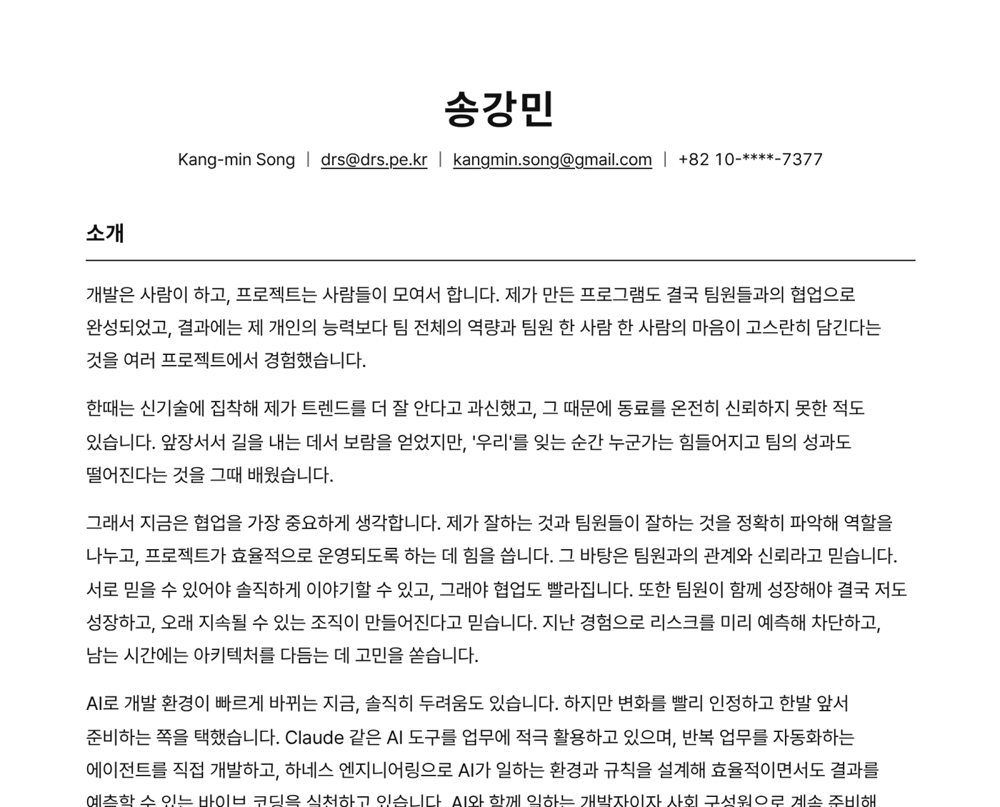
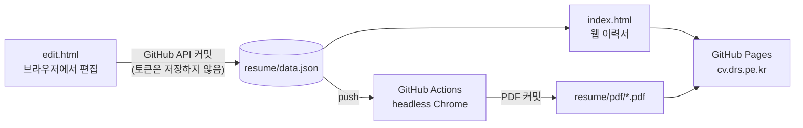

<div align="center">

# 송강민 · Kang-min Song

**JSON 파일 하나로 관리하는 이력서 — 웹에서 고치면 사이트와 PDF가 저절로 따라온다.**

[이력서 보기](https://cv.drs.pe.kr/resume/) · [PDF 내려받기](https://cv.drs.pe.kr/resume/pdf/resume.pdf) · [요약본 PDF](https://cv.drs.pe.kr/resume/pdf/resume-only.pdf)

[](https://github.com/drsmin/skm-cv/actions/workflows/resume-pdf.yml)

<picture>
  <source media="(prefers-color-scheme: dark)" srcset="docs/images/preview-dark.png">
  
</picture>

</div>

---

## 어떻게 돌아가나



- **데이터는 한 곳.** 이름, 소개, 기술, 프로젝트, 포트폴리오가 모두 [`resume/data.json`](resume/data.json)에 있습니다. 보기 페이지와 편집 페이지는 이 파일만 읽고 씁니다.
- **빌드가 없다.** 프레임워크도 번들러도 없는 순수 HTML·CSS·JS입니다. 저장소를 그대로 서빙하면 끝입니다.
- **브라우저에서 바로 저장.** [`edit.html`](https://cv.drs.pe.kr/resume/edit.html)에서 고치고 저장하면 GitHub Contents API로 커밋됩니다. 토큰은 저장 순간에만 메모리에 있고 어디에도 남지 않습니다.
- **PDF는 서버가 만든다.** 내용이 바뀔 때마다 GitHub Actions가 headless Chrome으로 A4 PDF를 다시 찍어 커밋합니다. 누가 어떤 브라우저로 인쇄하든 결과가 같습니다.

## 디자인

개발자 이력서에서 널리 쓰이는 [Jake's Resume](https://github.com/jakegut/resume) 배치를 한글에 맞게 옮겼습니다.

- 한 단 구성, 가운데 이름, 가로줄로 나눈 절 제목
- 항목마다 `제목 | 유형 ··· 기간` / `기술 ··· 근무 기간` 두 줄, 그 아래 글머리표
- 색 대신 굵기와 정렬로 위계를 만들고, 한글에 맞게 줄 간격을 넓혔습니다
- 끝난 지 12년이 넘은 프로젝트는 「이전 프로젝트」에 한 줄씩
- 다크 모드, 모바일, A4 인쇄(쪽 번호, 쪽 나눔)까지 같은 CSS 한 벌

폰트는 [Pretendard](https://github.com/orioncactus/pretendard) 정적 subset을 저장소에 직접 둡니다(OFL). 외부 CDN 없이 동작하고 PDF에도 깨끗한 TrueType으로 박힙니다.

## 구조

```
resume/
├── data.json          이력서 내용 전부
├── index.html         보기 페이지  ─ render.js · style.css
├── edit.html          편집 페이지  ─ edit.js · edit.css
├── fonts/pretendard/  Pretendard 정적 subset (OFL)
└── pdf/               Actions가 만드는 PDF (전체 · 포트폴리오 제외)
scripts/build-pdf.mjs  PDF 생성 (Playwright)
.github/workflows/     resume-pdf.yml
cv.html · portfolio.html   예전 이력서 (원본 보존)
```

## 로컬에서

```bash
# 보기·편집 페이지
python3 -m http.server 8000      # → http://localhost:8000/resume/

# PDF 만들기
npm install --no-save playwright@1.48.2 && npx playwright install chromium
node scripts/build-pdf.mjs       # → resume/pdf/resume.pdf · resume-only.pdf
```

## 기록

설계 결정과 작업 이력은 [`docs/`](docs/)에 남깁니다. 데이터 형식과 디자인 규칙은 [`docs/resume-design.md`](docs/resume-design.md), 결정 목록은 [`docs/decisions.md`](docs/decisions.md)에 있습니다.

<div align="center">
<sub>© Kang-min Song · 폰트 Pretendard (SIL OFL 1.1)</sub>
</div>
